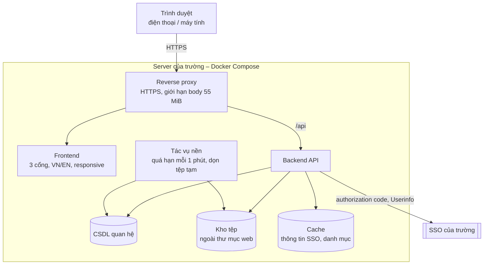
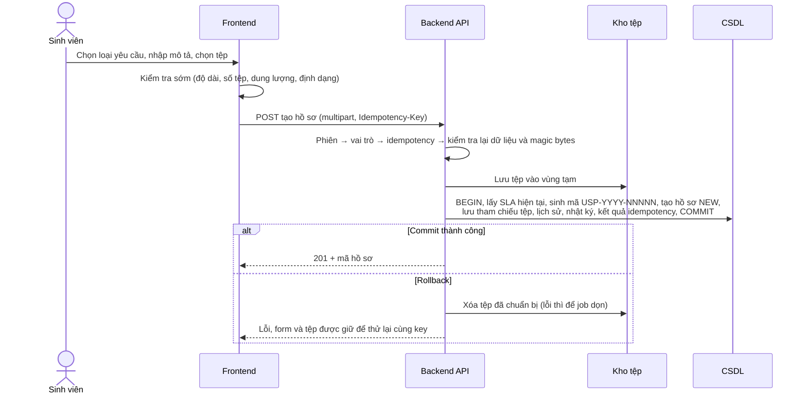
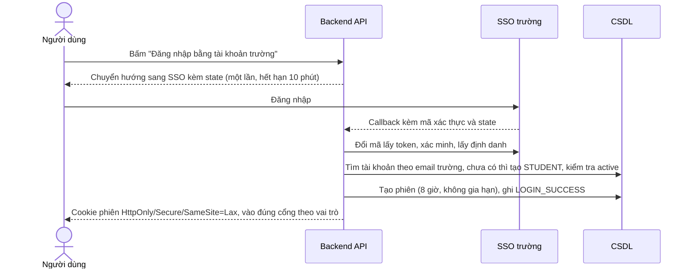
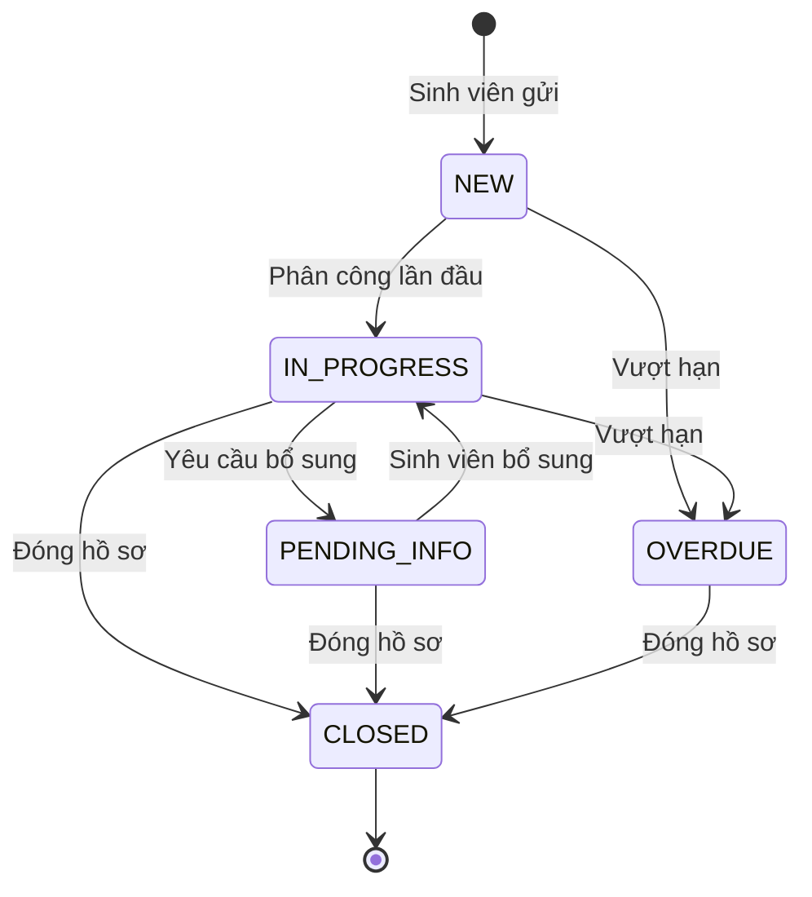

# Tổng quan kiến trúc

## Thành phần

| Thành phần | Trách nhiệm |
|---|---|
| Reverse proxy | Chỉ phục vụ HTTPS (HTTP chuyển hướng sang HTTPS); giới hạn tổng request multipart 55 MiB; chuyển `/api` vào backend |
| Frontend | Giao diện 3 cổng theo vai trò; đổi VN/EN; bố cục điện thoại và máy tính; kiểm tra sớm dữ liệu và tệp; polling thông báo 30 giây khi trang đang mở |
| Backend API | Phiên và phân quyền; nghiệp vụ hồ sơ; SLA; lịch sử và nhật ký; thông báo; báo cáo; nhận và trả tệp |
| Tác vụ nền | Chuyển hồ sơ quá hạn sang `OVERDUE` mỗi 1 phút, chỉ một tiến trình chạy tại một thời điểm; dọn tệp tạm không được tham chiếu |
| CSDL quan hệ | Dữ liệu nghiệp vụ, phiên, idempotency, lịch sử, nhật ký; cần transaction, sequence theo năm, unique constraint và phân quyền chỉ thêm/đọc trên bảng nhật ký |
| Kho tệp | Lưu tệp với tên ngẫu nhiên, không có đường dẫn công khai; chỉ trả qua API có kiểm tra quyền |
| Cache phía server | Thông tin tài khoản lấy từ SSO, 15 phút, riêng từng tài khoản (đặc tả module ghi Redis); danh mục loại yêu cầu và phòng ban |

## Cách backend xử lý một request ghi

Thứ tự kiểm tra cố định cho mọi API:

1. Phiên hợp lệ và chưa bị thu hồi.
2. Vai trò và trạng thái tài khoản (đọc từ CSDL ở mỗi request).
3. Phạm vi dữ liệu: ngoài phạm vi trả 404.
4. Quyền thao tác: trong phạm vi nhưng không có quyền ghi trả 403.
5. Kết quả idempotency đã lưu (nếu thao tác bắt buộc Idempotency-Key).
6. Version, trạng thái, kiểm tra nghiệp vụ.
7. Cập nhật nguyên tử: hồ sơ, lịch sử, nhật ký, thông báo, kết quả idempotency trong cùng một transaction.

## Luồng chính: sinh viên gửi yêu cầu kèm tệp

## Luồng chính: đăng nhập

## Vòng đời hồ sơ

`PENDING_INFO` tạm dừng SLA nên không chuyển sang `OVERDUE`. `OVERDUE` giữ nguyên khi được phân công, yêu cầu bổ sung hay nhận bổ sung; chỉ đổi khi đóng.

## Môi trường

| Môi trường | Dùng cho | SSO | Dữ liệu |
|---|---|---|---|
| Dev (máy lập trình viên) | Phát triển | Giả lập | Seed |
| Staging | Test trọn luồng từng milestone, nghiệm thu nội bộ | Giả lập | Seed, bộ 200 ticket mẫu |
| Production (server của trường) | Go-live | SSO thật; ứng dụng từ chối khởi động nếu bật giả lập | Danh mục thật do trường xác nhận; Admin đầu tiên nạp khi triển khai |

Đóng gói bằng Docker Compose, cấu hình qua `.env` (mẫu `.env.example` trong hồ sơ bàn giao). Bí mật (khóa SSO, khóa ký phiên, mật khẩu CSDL) không đưa vào repo.

## Công nghệ

Chưa chốt ngôn ngữ backend, framework frontend, hệ quản trị CSDL và kho tệp. Yêu cầu bắt buộc với lựa chọn:

- CSDL hỗ trợ transaction, sequence, unique constraint, khóa dòng và phân quyền theo bảng.
- Kho tệp nằm ngoài thư mục web và không phát URL công khai.
- Chạy được bằng Docker Compose trên hạ tầng của trường.

Prototype hiện tại (thư mục `prototype/`) chỉ là vỏ giao diện chạy luồng, không phải kiến trúc production.
