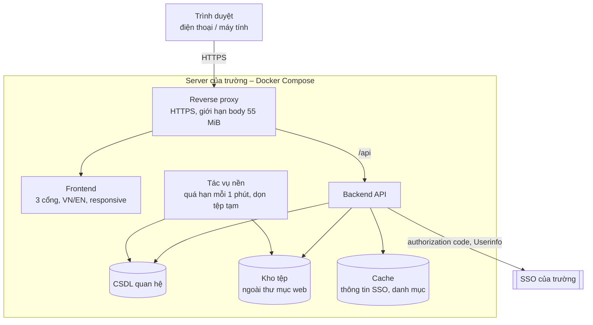
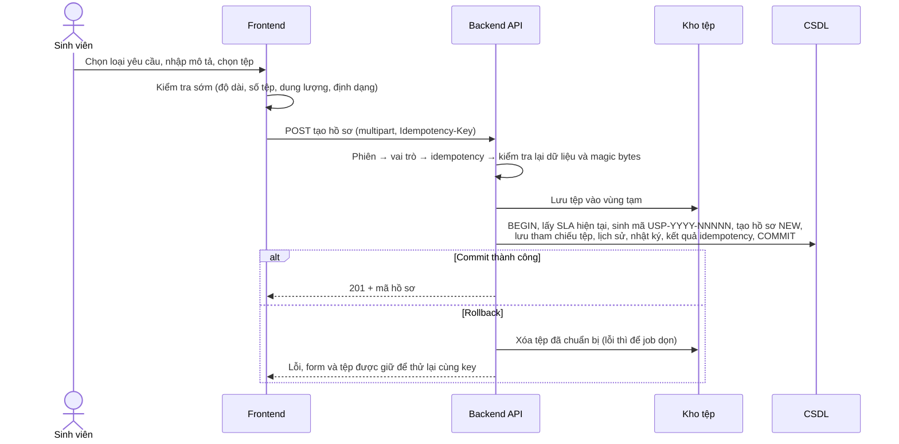
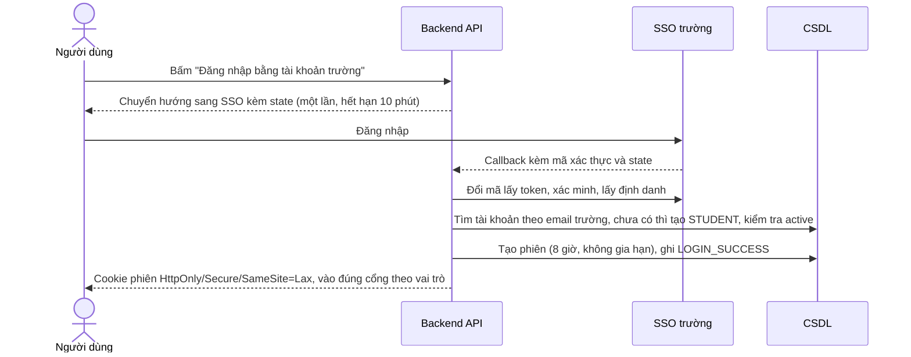
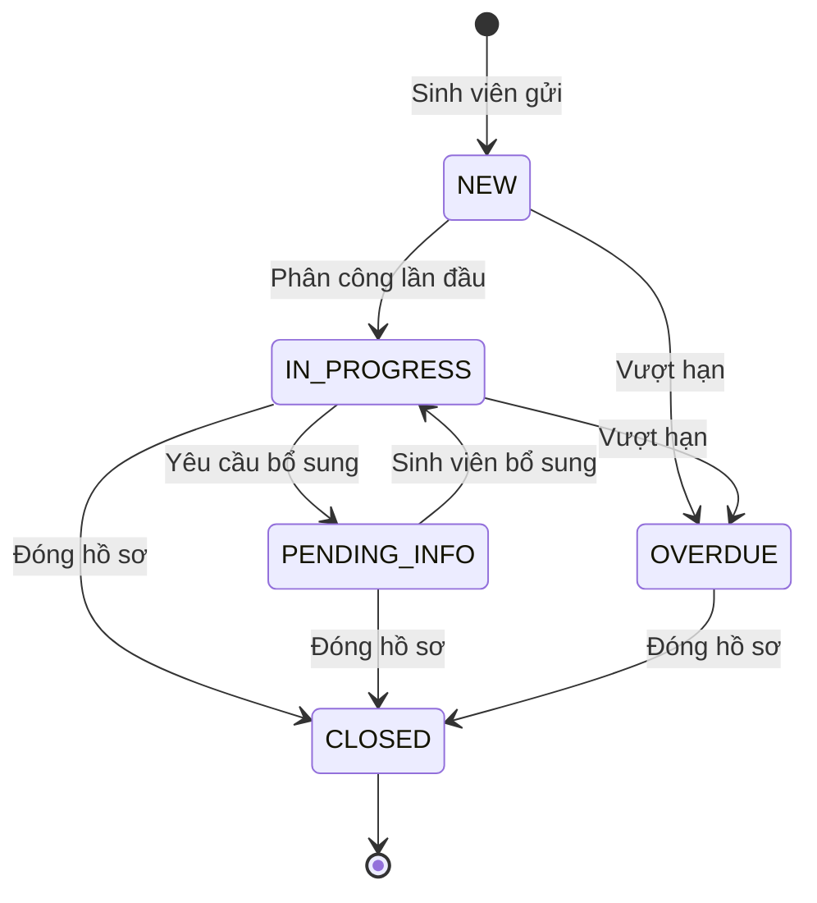

# Tổng quan kiến trúc

## Thành phần

| Thành phần | Trách nhiệm |
|---|---|
| Reverse proxy | Chỉ phục vụ HTTPS (HTTP chuyển hướng sang HTTPS); giới hạn tổng request multipart 55 MiB; chuyển `/api` vào backend |
| Frontend | Giao diện 3 cổng theo vai trò; đổi VN/EN; bố cục điện thoại và máy tính; kiểm tra sớm dữ liệu và tệp; polling thông báo 30 giây khi trang đang mở |
| Backend API | Phiên và phân quyền; nghiệp vụ hồ sơ; SLA; lịch sử và nhật ký; thông báo; báo cáo; nhận và trả tệp |
| Tác vụ nền | Chuyển hồ sơ quá hạn sang `OVERDUE` mỗi 1 phút, chỉ một tiến trình chạy tại một thời điểm; dọn tệp tạm không được tham chiếu |
| CSDL quan hệ | Dữ liệu nghiệp vụ, phiên, idempotency, lịch sử, nhật ký; cần transaction, sequence theo năm, unique constraint và phân quyền chỉ thêm/đọc trên bảng nhật ký |
| Kho tệp | Lưu tệp với tên ngẫu nhiên, không có đường dẫn công khai; chỉ trả qua API có kiểm tra quyền |
| Cache phía server | Lưu thông tin tài khoản lấy từ SSO trong 15 phút riêng từng tài khoản (`FR-STU-01/BR-05`, `NFR-PERF-10`) và cache danh mục (`NFR-PERF-11`); triển khai bằng Redis theo [ADR-005](technical-decisions/ADR-005-technology-stack-and-cache.md) |

## Cách backend xử lý một request ghi

Thứ tự kiểm tra cố định cho mọi API:

1. Phiên hợp lệ và chưa bị thu hồi.
2. Vai trò và trạng thái tài khoản (đọc từ CSDL ở mỗi request).
3. Phạm vi dữ liệu: ngoài phạm vi trả 404.
4. Quyền thao tác: trong phạm vi nhưng không có quyền ghi trả 403.
5. Kết quả idempotency đã lưu (nếu thao tác bắt buộc Idempotency-Key).
6. Version, trạng thái, kiểm tra nghiệp vụ.
7. Cập nhật nguyên tử: hồ sơ, lịch sử, nhật ký, thông báo, kết quả idempotency trong cùng một transaction.

## Luồng chính: sinh viên gửi yêu cầu kèm tệp

## Luồng chính: đăng nhập

## Vòng đời hồ sơ

`PENDING_INFO` tạm dừng SLA nên không chuyển sang `OVERDUE`. `OVERDUE` giữ nguyên khi được phân công, yêu cầu bổ sung hay nhận bổ sung; chỉ đổi khi đóng.

## Môi trường

| Môi trường | Dùng cho | SSO | Dữ liệu |
|---|---|---|---|
| Dev (máy lập trình viên) | Phát triển | Giả lập | Seed |
| Staging | Test trọn luồng từng milestone, nghiệm thu nội bộ | Giả lập | Seed, bộ 200 ticket mẫu |
| Production (server của trường) | Go-live | SSO thật; ứng dụng từ chối khởi động nếu bật giả lập | Danh mục thật do trường xác nhận; Admin đầu tiên nạp khi triển khai |

Đóng gói bằng Docker Compose, cấu hình qua `.env` (mẫu `.env.example` trong hồ sơ bàn giao). Bí mật (khóa SSO, khóa ký phiên, mật khẩu CSDL) không đưa vào repo.

## Công nghệ

Ngăn xếp công nghệ đã chốt ngày 17/09/2026 (Mô phỏng) tại [ADR-005](technical-decisions/ADR-005-technology-stack-and-cache.md), trạng thái **Chấp nhận**: backend TypeScript/NestJS, frontend React và TypeScript, CSDL PostgreSQL, cache phía server Redis, kho tệp là volume Docker gắn ngoài web root, đóng gói bằng Docker Compose. Giả định công nghệ dùng để ước lượng baseline (1109 giờ / 424.721.000 VNĐ) ghi ở **`A-14`** ([assumptions.md](../project/assumptions.md)) và rủi ro liên quan ở **`R-27`** ([risk-register.md](../management/risk-register.md)).

- **Vai trò quyết định và mốc chốt:** `BE Dev / Senior`, `FE Dev / Senior` và `DevOps / Mid` đề xuất ở **WBS `1.04–1.05` (`09/09–11/09/2026`, `#105`)**; `PM / Senior` và `BE Dev / Senior` xác nhận tương thích hạ tầng với Aurora University ở **WBS `1.11–1.14` (`14/09–17/09/2026`)**; ADR chuyển sang Chấp nhận ngày 17/09/2026, trước khi lập trình (`1.20–1.23`).
- **Yêu cầu bắt buộc mà ngăn xếp đã chọn phải đáp ứng** (kiểm lại nếu sau này đổi thành phần nào):
  - CSDL hỗ trợ transaction, sequence, unique constraint, khóa dòng và phân quyền theo bảng.
  - Bộ nhớ đệm phía server đáp ứng TTL 15 phút tách biệt theo từng tài khoản (`FR-STU-01/BR-05`, `NFR-PERF-10`) và cache danh mục (`NFR-PERF-11`).
  - Kho tệp nằm ngoài thư mục web và không phát URL công khai.
  - Đóng gói và chạy được bằng Docker Compose trên hạ tầng của trường (`A-11`, `A-14`).

Prototype 3 cổng dữ liệu mẫu là sản phẩm đầu ra theo kế hoạch ở tuần 1–2 của `MS-01` (WBS `1.07–1.09`, các issue `#107`, `#108`, `#110`) để Aurora University bấm thử và chốt yêu cầu; bản mẫu này không lưu trong kho tài liệu quản lý dự án hiện tại (không có thư mục `prototype/` trong repo) và chỉ là vỏ giao diện chạy luồng, không phải kiến trúc production.
