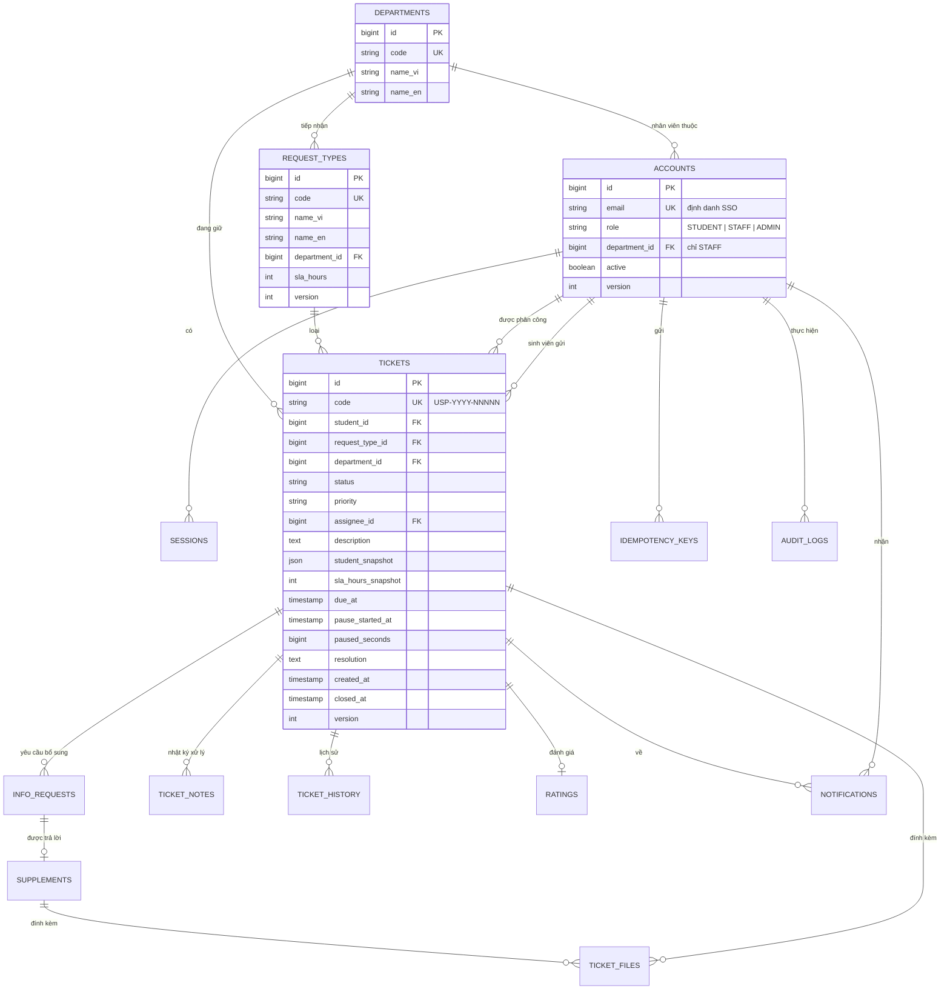

# Mô hình dữ liệu

Tên bảng và tên cột là đề xuất, chốt khi viết migration. Ràng buộc nghiệp vụ (giới hạn, unique, append-only) lấy từ các module và là bắt buộc.

## ERD

## Các bảng

| Bảng | Nội dung | Ràng buộc chính |
|---|---|---|
| `accounts` | Tài khoản 3 vai trò | `email` unique; đúng một `role`; `department_id` bắt buộc khi gán quyền xử lý cho `STAFF`; có `version` |
| `sessions` | Phiên ứng dụng | TTL 8 giờ không gia hạn; `revoked_at` để thu hồi ngay; token SSO lưu phía server, không gửi trình duyệt |
| `departments` | Phòng ban | `code` cố định; tên VI/EN; không xóa khi đã có hồ sơ tham chiếu |
| `request_types` | Loại yêu cầu | Ánh xạ đúng một phòng ban; `sla_hours` số nguyên 1–720, Admin sửa được; có `version`; seed không ghi đè SLA đã sửa |
| `tickets` | Hồ sơ | `code` unique theo `USP-YYYY-NNNNN`; `status` ∈ NEW, IN_PROGRESS, PENDING_INFO, OVERDUE, CLOSED; `priority` ∈ LOW, MEDIUM, HIGH (mặc định MEDIUM); `description` 20–2000 ký tự; `resolution` 10–2000 ký tự, bắt buộc khi đóng; `version` tăng mỗi thao tác thay đổi |
| `ticket_code_sequences` | Số thứ tự mã theo năm | Mỗi năm một sequence; có thể nhảy số do rollback, không tái sử dụng |
| `ticket_files` | Metadata tệp | PDF/JPG/PNG theo magic bytes; ≤ 10.485.760 byte/tệp; ≤ 5 tệp/lần; tên gốc ≤ 255 ký tự đã sanitize; `storage_key` ngẫu nhiên; gắn với hồ sơ hoặc lần bổ sung |
| `info_requests` | Yêu cầu bổ sung của nhân viên | Gắn hồ sơ; nội dung 10–1000 ký tự; mỗi hồ sơ tối đa một yêu cầu đang mở, đóng khi sinh viên bổ sung hoặc hồ sơ đóng; công khai với sinh viên chủ hồ sơ |
| `supplements` | Sinh viên bổ sung | Nội dung 10–2000 ký tự; trả lời một yêu cầu bổ sung đang mở |
| `ticket_notes` | Nhật ký xử lý nội bộ | Nội dung 1–2000 ký tự; chỉ người phụ trách ghi; chỉ nhân viên phòng đang giữ hồ sơ đọc |
| `ticket_history` | Dòng thời gian nghiệp vụ | Append-only; `visibility` PUBLIC/INTERNAL; `department_at_event`; mốc public không chứa `due_at`, priority, người phụ trách, lý do; lý do chuyển phòng và escalate (10–500 ký tự) chỉ nằm ở mốc INTERNAL |
| `ratings` | Đánh giá sau khi đóng | Unique theo `ticket_id`; `rating` số nguyên 1–5; `comment` ≤ 1000 ký tự, có thể trống |
| `notifications` | Thông báo trong app | Thuộc một sinh viên; mỗi sự kiện tối đa một thông báo; `read_at` |
| `idempotency_keys` | Kết quả thao tác đã thực hiện | Unique theo tài khoản + thao tác + đối tượng + key; lưu hash payload và kết quả; TTL 24 giờ sau hoàn tất |
| `audit_logs` | Nhật ký hệ thống | Append-only, tài khoản CSDL của ứng dụng chỉ có quyền INSERT/SELECT; unique `event_id` + `action` + `object_id`; không lưu nội dung nhạy cảm |

## Quy ước chung

- Thời gian lưu UTC; hiển thị và tính theo ngày dùng giờ Việt Nam (UTC+7). Hạn xử lý dùng thời gian server.
- Văn bản người dùng nhập là văn bản thuần; độ dài tính theo ký tự Unicode sau khi trim.
- Thay đổi hồ sơ, lịch sử, nhật ký, thông báo và kết quả idempotency nằm trong cùng một transaction, dùng chung `event_id`.
- Thời gian xử lý (báo cáo) = `closed_at` − `created_at` − tổng thời gian ở `PENDING_INFO`.
