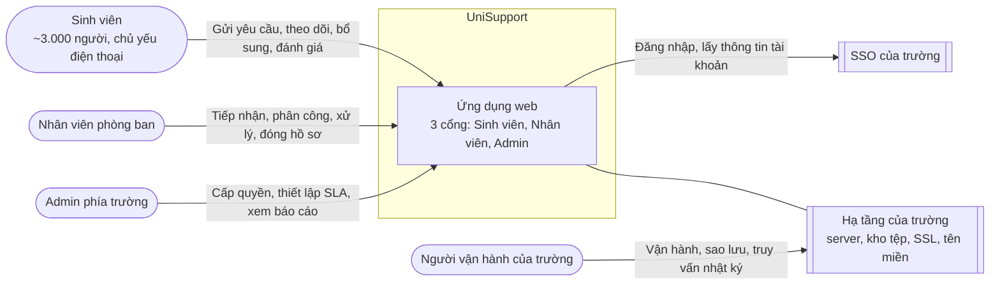

# Bối cảnh hệ thống (System Context)

## Sơ đồ

## Người dùng

| Người dùng | Vai trò trong hệ thống | Dùng gì |
|---|---|---|
| Sinh viên | `STUDENT` | Cổng Sinh viên |
| Nhân viên phòng ban | `STAFF`, gắn với một phòng ban | Cổng Nhân viên |
| Admin | `ADMIN` | Cổng Admin |
| Người vận hành của trường | Không có tài khoản trong ứng dụng | Truy cập server và CSDL theo quyền vận hành |

Mỗi tài khoản có đúng một vai trò. Tài khoản tạo lần đầu qua SSO mặc định là `STUDENT`; tài khoản `STAFF` và `ADMIN` do Admin thêm trước. Admin đầu tiên được nạp khi triển khai.

## Hệ thống bên ngoài

| Hệ thống | Dùng để | Ghi chú |
|---|---|---|
| SSO của trường | Xác thực người dùng; lấy họ tên, MSSV, khoa, lớp, email, số điện thoại | Môi trường dev và test dùng SSO giả lập; production luôn tắt giả lập |
| Hạ tầng của trường | Chạy ứng dụng, lưu CSDL và tệp, cấp chứng chỉ SSL và tên miền | Trường chi trả và vận hành sau bàn giao (Proposal 6.4) |

## Ranh giới phạm vi

Không có trong hệ thống:

- Tích hợp SIS/LMS, thanh toán; tự động ra quyết định học vụ.
- Ứng dụng di động riêng (chỉ có web responsive).
- Gửi email, SMS, push. Thông báo chỉ hiển thị trong ứng dụng.
- Trích xuất dữ liệu; màn hình xem nhật ký hệ thống; màn hình sửa danh mục.
- Admin xem chi tiết hồ sơ, xem tệp hoặc xử lý hồ sơ.
